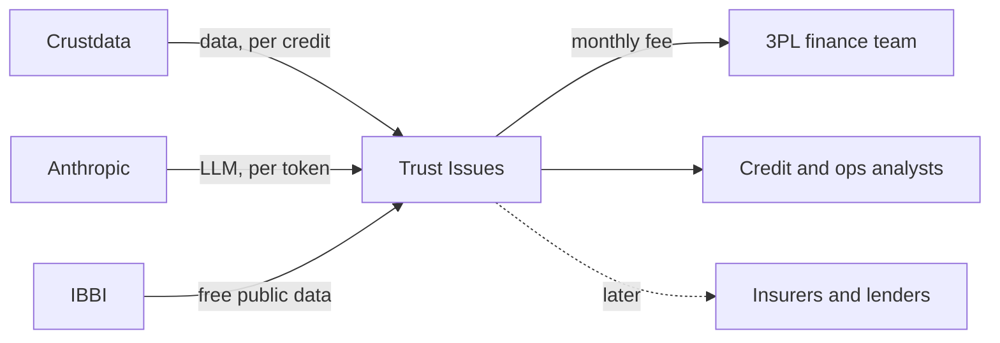

# Trust Issues: business architecture

Trust Issues (Threat and Risk Understanding System for Tracking Institutional Stability) is a
weekly counterparty risk review sold to third-party logistics companies.

Costs below marked "measured" come from our own test runs and the cost ledger. Anything marked
"assumption" is a planning number we have not validated with a customer.

## 1. The problem

A 3PL depends on two groups of companies. If a carrier or warehouse fails, shipments stop. If a
customer on credit terms fails, the unpaid invoices are usually lost. Most mid-size 3PLs check these
companies by hand, once a month or once a quarter, and the check is often skipped when the team is
busy.

## 2. Who buys and who uses it

The buyer is the CFO or head of credit, paying from the credit-control or insurance budget. The
daily users are credit analysts, who review customers, and operations or procurement staff, who
look after carriers and warehouses. Later, trade-credit insurers and supply-chain lenders could take
the same monitoring as a data feed; we have not spoken to any yet.

## 3. Pricing

We plan to charge ₹1,500 per counterparty per month, which covers four weekly reviews and re-checks
when a monitored company's data changes (assumption).

For a 3PL the size of our demo portfolio, with 24 suppliers and 400 customers, that comes to about
₹6.4 lakh a month, or ₹76 lakh a year.

## 4. Cost per counterparty

| Item | Basis | ₹ per month |
|---|---|---|
| Crustdata | 4.5 to 6.5 credits per review (measured), ₹2 to ₹3 per credit (assumption) | 50 to 80 |
| Claude | 2,000 to 4,000 tokens per review (measured) | 10 to 20 |
| Hosting and support | assumption | 50 to 100 |
| Total | | 110 to 200 |

At ₹1,500 per month that leaves a gross margin of roughly 87 to 93 percent. A second review in the
same week reuses cached data and costs almost nothing, and each run has a credit cap set in
`config.yaml`, so a large list cannot overspend.

## 5. What a buyer needs to see

Credit teams will not hand decisions to a tool that might be confidently wrong or that might email
their customers by itself. So the product is built around a few rules. It never guesses which
company a name refers to. If a data source fails, the company is put on hold rather than passed. A
person approves every email, credit hold or supplier request before it is sent. Every fact links to
where it came from, and every cost is recorded. On our 12 test cases it gave no wrong "trusted"
verdicts.

## 6. Risks

- We depend on one main data provider. All calls go through one client, so switching or adding a
  provider is contained, and the insolvency registry gives an independent check.
- Small firms with little online presence are hard to assess. They come back as "can't tell" rather
  than being marked risky; GST and bank data, shared with consent, would close the gap.
- Personal data. We only look at companies, and at people only in their public roles (name, title,
  employer, dates).

## 7. Next steps

1. Run a pilot with one mid-size 3PL on its real counterparty list.
2. Connect to the ERPs our customers use (SAP, Tally) for credit holds, and to their transport
   systems for carrier on-time data.
3. Add GST filing and bank statement signals, with the counterparty's consent.
4. Talk to trade-credit insurers about a monitoring feed for the same portfolios.
