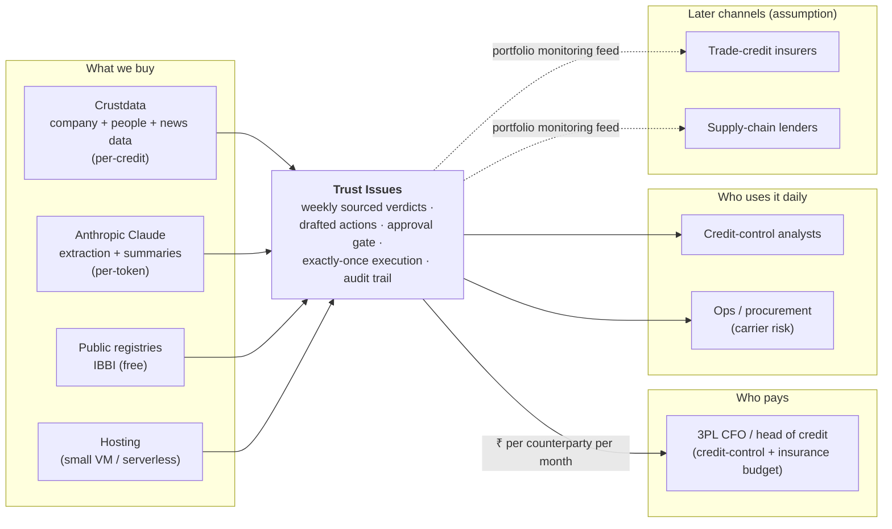
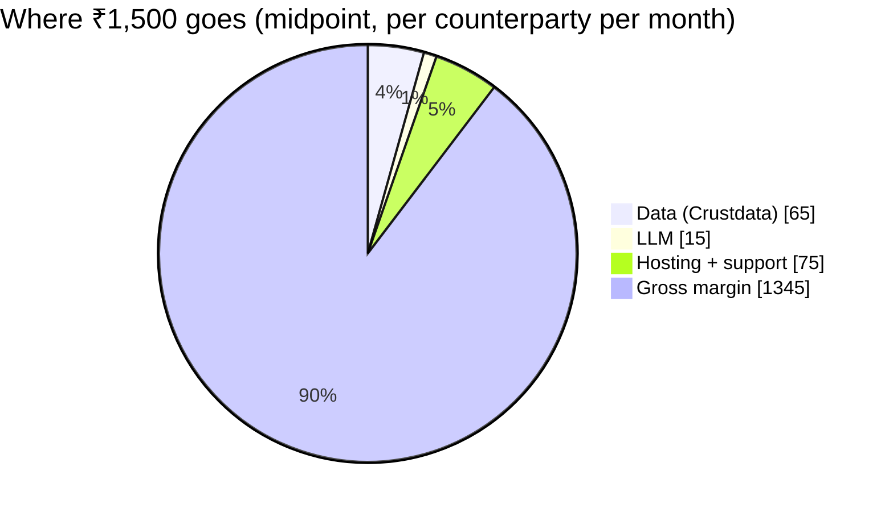

# Trust Issues: business and financial architecture

**T**hreat and **R**isk **U**nderstanding **S**ystem for **T**racking **I**nstitutional **S**tability.
The engineering view is in [`TECHNICAL_ARCHITECTURE.md`](TECHNICAL_ARCHITECTURE.md).

Figures marked *measured* come from our probe run and ledger (`tests/fixtures/README.md`,
README "Costs"). Figures marked *assumption* are planning inputs, not data.

## 1. Value chain

## 2. The problem we price against

A 3PL depends on carriers and warehouses (if one fails, shipments stop) and extends credit to
customers (if one fails, invoices are lost). Today an analyst reviews them by hand, monthly or
quarterly. Trust Issues does that loop every week, cites every fact, and drafts the follow-up.

## 3. Revenue model

- **Price:** ₹1,500 per counterparty per month (four weekly reviews + Watcher re-checks).
- **Tiers (assumption):** Starter up to 100 counterparties; Growth up to 500; Enterprise with ERP
  integration, SSO and custom rules.
- **Example account (the Kaveri Freight demo shape, assumption):** 24 vendors + 400 customers =
  424 counterparties → **₹6.36 L per month** (≈ ₹76 L per year).

## 4. Unit economics (per counterparty per month)

| Line | Basis | ₹ / month |
|---|---|---|
| Revenue | list price | **1,500** |
| Crustdata data | ≈ 4.5–6.5 credits per weekly review *(measured)*, cache makes repeat runs ~0; ₹2–3 per credit *(assumption)* | 50–80 |
| LLM | ≈ 2–4k tokens per counterparty per review *(measured)* | 10–20 |
| Hosting + support | *(assumption)* | 50–100 |
| **Gross margin** | | **≈ 87–93%** |

## 5. Why a buyer says yes

| Buyer fear | What Trust Issues does |
|---|---|
| "A bad customer slips through" | Weekly checks; RED and AMBER surface with ₹ at risk and a drafted terms change or credit hold |
| "The tool will be confidently wrong" | Never guesses identity; failed sources → HELD; zero wrong GREENs on the graded set (12/12) |
| "It will email my customers on its own" | Nothing irreversible without a named approver; senior sign-off for strategic accounts |
| "I can't audit it" | Every fact links to its source and date; every rating has a points breakdown; every call is in the cost ledger |

## 6. Costs we control

- **Credit caps** per counterparty and per run stop a review cleanly (`limits` in `config.yaml`).
- **Caching** makes the second review in a week nearly free.
- **Rules, not an LLM, decide verdicts**, so model costs stay small and predictable.

## 7. Risks

| Risk | Mitigation |
|---|---|
| Data-provider dependency | One client (`crd/data/crustdata.py`) isolates the provider; registries add independent signals |
| Thin coverage for small firms | CANNOT VERIFY instead of a penalty; GST/bank signals with consent are on the roadmap |
| Regulatory / personal data | Companies only; people limited to public roles; person data purged per run |

## 8. What comes next (commercial)

1. Pilot with one mid-size 3PL on its real list (live mode).
2. ERP connectors for credit holds (SAP, Tally) and TMS on-time data for carriers.
3. Consent-based GST filing and bank-statement signals.
4. A monitoring feed for trade-credit insurers covering the same portfolios.
