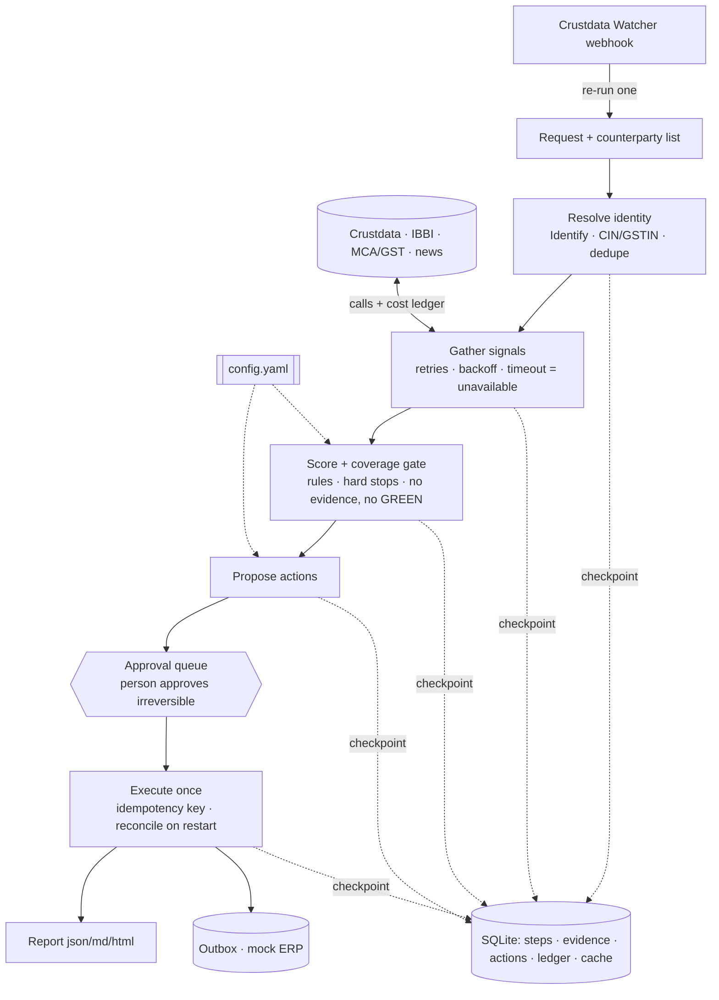

# Prachi — P3 Product (UI, approvals, exactly-once actions, delivery)

> Trust Issues · ContextCon 05 · BITS Pilani · 22 Nov 2026
> Teammates: **Arth** (P1 Core, lead/integrator) · **Nilay** (P2 Data)
> Shared rules: `CLAUDE.md` · Team overview: `docs/TEAM_PLAN.md` · This file: `docs/PRACHI_product.md`

---

## 1. Your role in one paragraph

You own **everything the judges see, click and read**:

- the web UI (dashboard, live progress, counterparty detail, approval queue, outbox, ledger);
- the **approval gate** and the **exactly-once executor** that sends emails, places credit holds and sends RFQs;
- the report (json, md, html);
- the **test cases**;
- the README, the architecture diagram and the 2-minute demo video;
- **both submission forms** (14:30 checkpoint and 18:00 final).

**What the judges test that depends on you:**

- a person approves anything irreversible;
- after a kill, each action happens exactly once;
- every fact is clickable to its source;
- the demo is clear;
- the README answers every handbook question.

---

## 2. Your timeline

| Time | Task | Section | Notes |
|---|---|---|---|
| 13:20–13:50 | **Test cases**: find real examples, write the first 6 yaml files | 4 | dated after 1 Sep 2026 |
| 13:30–14:20 | FastAPI app skeleton, base template, dashboard, approvals and outbox pages on mock data | 5 | Arth's contracts land at 13:45 |
| 13:50–14:20 | `actions/policy.py` | 6 | |
| 14:20–14:30 | Rough README; **submit the checkpoint form** | 9 | the latest submission counts |
| 14:30–15:30 | `actions/executor.py` + `channels.py` + `tests/test_executor.py` | 7 | the most important robustness piece |
| 15:00–15:45 | Live progress page (HTMX polling + ledger ticker) | 5 | the star of the demo |
| 15:30 | **Sync:** live mode on 5 counterparties | | |
| 15:30–16:15 | `report/render.py`, counterparty detail page, ledger page | 5, 8 | |
| 16:15–16:30 | Webhook route `/webhooks/crustdata` + ngrok, test with Nilay | 5 | |
| 16:00–16:30 | Test cases 7–12 | 4 | |
| 16:30 | **Sync:** full test-case run, triage | | |
| 16:30–17:15 | README (full), `docs/architecture.md` (Mermaid) | 9 | |
| 17:15 | **Feature freeze** | | |
| 17:15–17:45 | Record the demo video (Loom), with Arth running the kill | 10 | |
| 17:45–18:00 | **Submit the final form** | 9 | |

---

## 3. Files you own

```
crd/actions/__init__.py   crd/actions/policy.py   crd/actions/executor.py   crd/actions/channels.py
crd/report/__init__.py    crd/report/render.py    crd/report/templates/report.html.j2
crd/web/__init__.py       crd/web/app.py          crd/web/templates/*.html   crd/web/static/style.css
tests/cases/*.yaml        tests/test_executor.py
README.md                 docs/architecture.md    scripts/demo_kill.sh (with Arth)
```

You **use**, and never edit, Arth's `crd/models.py`, `crd/db.py`, `crd/config.py` and `crd/orchestrator.py`, and Nilay's `crd/data/watcher.py`. Arth pushes the contracts at 13:45. Until then, build pages against hard-coded sample dicts shaped like section 11. Need a DB function or field? Message Arth with the exact signature.

---

## 4. Test cases (13:20–13:50 for the first 6, then 16:00–16:30 for the rest)

The hidden test set has duplicates, lookalike names and unanswerable questions. Our own cases must cover the same traps. Use web search to find **real** companies and events **dated after 1 Sep 2026**.

### 4.1 File format: `tests/cases/<nn>_<slug>.yaml`

Arth's runner reads exactly these keys:

```yaml
id: "03_insolvency"
request: "Check our customer XYZ Retail Pvt Ltd before we renew 45-day terms."
as_of: "2026-11-22"
input_rows:
  - cp_id: "C-103"
    name: "XYZ Retail"
    legal_name: "XYZ Retail Private Limited"
    domain: "xyzretail.in"
    role: "customer"            # carrier | warehouse_lessor | vendor | customer
    criticality: "na"           # sole_source | primary | backup | na
    exposure_inr: 3500000
    credit_terms_days: 45
    account_owner: "credit-team"
expected:
  rating: "RED"                 # or a list: ["AMBER", "RED"]
  hard_stop: "cirp_admitted"    # optional
  must_cite: ["ibbi.gov.in"]    # substrings that must appear in some evidence url / source / field_path
  must_not: ["GREEN"]
  merged_cp_ids: []             # duplicates: ["C-201", "C-202"]
notes: >
  IBBI public announcement of CIRP dated <date>: <url>. Correct because <reason>.
```

### 4.2 The 12 cases to write

| # | File | What to find | Expected |
|---|---|---|---|
| 1 | `01_healthy_carrier` | A large listed Indian logistics company, stable, no bad news since Sep 2026 | GREEN; must_cite `headcount`; must_not RED |
| 2 | `02_distressed_customer` | An Indian D2C brand or startup with layoffs or a shutdown reported after Sep 2026 | [AMBER, RED]; must_cite the article domain; must_not GREEN |
| 3 | `03_insolvency` | A company in an IBBI CIRP announcement after Sep 2026 that could plausibly be a 3PL customer or vendor | RED; hard_stop; must_cite `ibbi` |
| 4 | `04_lookalike` | A common name ("Sharma Transport", "Shree Logistics"), with no domain, CIN or city | CANNOT_VERIFY; must_not GREEN, RED |
| 5 | `05_duplicate` | One real company as two rows: brand only, then legal name + domain | merged_cp_ids both; rating as for that company |
| 6 | `06_no_footprint` | A tiny private fleet owner with no web presence (a real one from a directory, or an obviously local name) | CANNOT_VERIFY |
| 7 | `07_false_alarm` | A company whose headcount fell because of a demerger or acquisition reported after Sep 2026 | not RED; must_cite the news url |
| 8 | `08_leadership_exit` | A company whose CEO/CFO left after Sep 2026 (reported in the news) | [AMBER, RED]; must_cite `Person Enrich` or the article |
| 9 | `09_namesake_news` | Bad news about company A; the test row is a *different* company with a similar name | rating not affected by that article; must_not RED |
| 10 | `10_source_failure` | Any company. Run with Nilay's env flag to force a registry timeout (agree the flag with him, e.g. `CRD_FAIL_SOURCES=registries`) | HELD or CANNOT_VERIFY; must_not GREEN |
| 11 | `11_reworded` | The same company as #1, with a totally different request wording | same as #1 |
| 12 | `12_kill_mid_action` | A RED customer with exposure over ₹10L | handled by `tests/test_executor.py` + the demo; yaml documents the expectation: 1 outbox row |

**Ethics rule:** test subjects are companies. People appear only as a company's officers with public roles. Never pick a private individual.

Keep a sources list in each case's `notes`. These double as the README's "How we tested" section.

---

## 5. Web UI (13:30–16:30, incremental)

### 5.1 Stack
- FastAPI + Jinja2 templates + **HTMX** + **Pico.css**, both from CDNs. No build step, no React.
  ```html
  <link rel="stylesheet" href="https://cdn.jsdelivr.net/npm/@picocss/pico@2/css/pico.min.css">
  <script src="https://unpkg.com/htmx.org@1.9.12"></script>
  ```
- Run: `uvicorn crd.web.app:app --reload --port 8000`.
- `crd/web/templates/base.html`:
    - A top nav: **Trust Issues** · Dashboard · Approvals (with a badge showing the pending count) · Outbox · Ledger · Runs.
    - A footer: "Every fact links to its source · Irreversible actions need approval · Costs recorded per call".

### 5.2 Visual language
- Rating badges, as pill `<span class="badge r-GREEN">`:

  | Rating | Colour |
  |---|---|
  | GREEN | `#1a7f37` |
  | AMBER | `#b26b00` |
  | RED | `#c62828` |
  | CANNOT VERIFY | grey `#6b7280` |
  | HELD | purple `#6d28d9` |

  Use white text, bold, small caps, letter-spacing.
- Every fact is followed by `<a class="src" href="{url}" target="_blank">source ↗</a> · {record_date}`. If there is no url but there is a `raw_ref`, link to `/raw/{run_id}/{file}`, which serves the stored JSON response.
- ₹ formatting: Indian grouping and units (`₹42.0 L`, `₹1.2 Cr`). Write a Jinja filter `inr`.
- Keep it calm and dense: tables, not cards everywhere. One accent colour, no gradients.

### 5.3 Routes

| Route | Page and behaviour | Data |
|---|---|---|
| `GET /` | **Dashboard.** A request `<textarea>` prefilled with "Run this week's risk review on all our carriers and customers", a file input for the counterparty CSV (optional; otherwise the stored list), and a **Run review** button. Below it, the latest run: four count tiles (RED / AMBER / CANNOT VERIFY+HELD / GREEN), credits, ₹, minutes. Then a **table ranked by ₹ at risk**, with columns from `config.get().report.fields`; each row links to the detail page | `db.list_runs`, `db.get_assessments`, `db.run_costs` |
| `POST /runs` | Save an uploaded CSV to `var/uploads/`, call `orchestrator.run_review_async(text, path)`, then `303` → `/runs/{id}` | Arth |
| `GET /runs` | A list of runs: id, started, status, n, credits, ₹ | `db.list_runs` |
| `GET /runs/{id}` | **Live progress.** A header with the status and the request text. A `<div hx-get="/runs/{id}/progress" hx-trigger="every 2s" hx-swap="innerHTML">`. When status is done or partial, show the "Open report" button and stop polling (return the partial without `hx-trigger`) | |
| `GET /runs/{id}/progress` | Partial: a progress bar (done/total); a **step grid** with counterparty rows × columns resolve, gather, score, propose, showing ✓ / ⟳ / ✗; and a **ledger ticker** with the last 10 calls (endpoint, credits, ms, status; cached shown in grey) plus running totals | `orchestrator.run_progress` |
| `GET /runs/{id}/report` | Embeds `var/runs/{id}/review.html`, with download links for `review.json`, `review.md` and the `ledger.csv` you generate | `render.render` |
| `GET /cp/{run_id}/{cp_id}` | **Detail card** (section 5.4) | `explain.why`, `db.get_assessment`, `db.get_evidence` |
| `GET /approvals` | **Approval queue** (section 5.5) | `db.get_actions("pending_approval")` |
| `POST /approvals/{action_id}` | Form fields `decision` (approve/reject), `approver` (required), `draft` (textarea). Behaviour in 5.5 | |
| `GET /outbox` | Two tables: **Sent messages** (`db.list_outbox()`: time, channel, to, subject, idempotency key) and **ERP holds** (`db.list_erp_holds()`). Header line: "N actions executed · each idempotency key appears once". This page proves exactly-once on stage | |
| `GET /ledger` | Filter by run. Table: ts, provider, endpoint, credits, ₹, tokens, ms, status, note. Totals at the top: credits, ₹, calls, cached %, errors. A button downloads it as CSV | `db.get_ledger`, `db.run_costs` |
| `GET /raw/{run_id}/{file}` | Serve `var/runs/{run_id}/raw/{file}` as JSON. **Sanitise the path**: allow only `[A-Za-z0-9_.-]` and no `..` | |
| `POST /webhooks/crustdata` | Read the raw body → `watcher.verify_signature(headers, raw)`; if False, return 401. Then `db.save_watch_event(...)`; if it is a duplicate, return 200. Then, for each domain in `watcher.parse_payload(body)`, start `orchestrator.run_single(domain, "watcher")` in a thread. Return 200 in under 1 s | Nilay + Arth |
| `GET /health` | `{"ok": true, "mock": CRD_MOCK}` | |

**On startup** (`@app.on_event("startup")` or lifespan):

1. `db.init_db()`;
2. `executor.reconcile()`;
3. in a thread, `orchestrator.resume()`.

This is what makes "restart the server" in the kill demo continue the run and finish the action exactly once.

### 5.4 Counterparty detail page `/cp/{run_id}/{cp_id}`
- **Header:** the display name, role, rating badge, score/100, ₹ exposure and ₹ at risk, and `change_since_last` if any (e.g. "GREEN → AMBER").
- **Explanation:** 2 sentences. Render `[ev_xxx]` markers as superscript links that jump to that evidence row.
- **"Why this rating" table** (from `explain.why`): start 70 → one row per signal (signal, points, note, evidence links) → hard stop → coverage check (passed/failed, which signals) → final score.
- **Cannot verify / Held** box (grey or purple), showing the fixed-format lines.
- **Conflicts** box, if any.
- **Evidence list:** every Evidence item, with signal, claim, `passage` in quotes (news), source, field_path, record_date, a **stale** tag when stale, an **unavailable** tag in purple, and the source link.
- **Identity:** the match type and confidence; for ambiguous entities, a candidates table.
- **Actions for this counterparty:** type, status, link to the approval.

### 5.5 Approval queue `/approvals`
- One card per pending action:
    - type (human label: "Email customer about credit terms", "Place credit hold", "Request quote from backup carrier");
    - counterparty with its rating badge;
    - **to:** (always the team inbox) and **subject**;
    - the draft in an editable `<textarea>`;
    - the **reasons**: evidence claims with source links;
    - a required **Approver name** input;
    - **Approve** and **Reject** buttons.
- POST behaviour:
    1. Approve → `draft = form.draft`, then `transition_action(action_id, "pending_approval", "approved", draft=draft, draft_hash=sha256(draft), approved_by=approver, approved_at=now)`.
       If it returns False, show "This action changed since you opened it. Reload."
       Then start `executor.execute_approved()` in a thread and redirect to `/approvals?done={action_id}`.
    2. Reject → `transition_action(..., "rejected", approved_by=approver)`.
- Show a "Recently decided" list underneath: the last 10, with status and executed time.
- A banner at the top: "Nothing here is sent until a person approves it. During the event, all messages go to our team inbox only."

---

## 6. `crd/actions/policy.py` (13:50–14:20)

```python
def propose(a: Assessment, cp: Counterparty, cfg, review_id: str) -> list[Action]
```

The rules come from `cfg.actions`:

| Action | When | reversible | Initial status |
|---|---|---|---|
| `internal_alert` | `a.change_since_last` is set, or the rating is RED or CANNOT_VERIFY | True | `approved` (auto) |
| `raise_watch_frequency` | rating in `[AMBER, RED]` | True | `approved` (auto) |
| `customer_terms_email` | role customer, rating in `on`, exposure ≥ `min_exposure_inr` | False | `pending_approval` |
| `credit_hold` | role customer, rating RED | False | `pending_approval` |
| `backup_rfq` | role supplier (carrier/vendor/warehouse_lessor), rating in `on`, criticality in `only_criticality` | False | `pending_approval` |
| `guarantee_request` | customer, RED, exposure ≥ 2 × `min_exposure_inr` | False | `proposed` (draft only, never executed) |

- HELD and CANNOT_VERIFY never trigger irreversible actions; only `internal_alert` ("needs a person: <what is missing>").
- For each action:
    - `action_id = "act_" + uuid[:8]`;
    - `idempotency_key = f"{cp.cp_id}:{type}:{review_id}"`;
    - `to = os.getenv("TEAM_INBOX")`;
    - `reason_evidence` = the evidence ids of the 2 most negative SignalScores.
    - Call `db.insert_action(action)`. If it returns False (the key exists), fetch the existing action and return that instead. This is what makes re-runs and resumes safe.
- **Draft templates:** short, factual and polite. No personal data. No accusations. At most 2 reasons, in plain words.
    - **Terms email** — subject: "Review of credit terms — {cp.name}". Body: "Dear {cp.name} team, following our periodic account review we would like to discuss moving terms on new shipments from {credit_terms_days} to {new_terms} days from {date}. Our review noted: {reason1}; {reason2}. Existing invoices are unaffected. Could we set up a call this week? — Credit team, {client_name}". `new_terms` = 15 for RED and half the current terms for AMBER; put this in config if Arth agrees.
    - **Credit hold** (internal ERP note): "Hold new credit shipments for {cp.name} ({cp_id}). Rating RED, score {score}. Reasons: {reason1}; {reason2}. Evidence: {ids}. Review by {account_owner}."
    - **Backup RFQ** — subject: "Rate request — lanes currently served by {cp.name}". Body: a request for a quote, sent to the team inbox, with a placeholder listing `alt_suppliers`.
    - **Internal alert:** "{cp.name}: {old} → {new}. {explanation}" (to Slack or the outbox).

---

## 7. `crd/actions/executor.py` + `channels.py`: exactly-once (14:30–15:30)

### 7.1 `channels.py`
```python
def send_email(key: str, to: str, subject: str, body: str) -> str
    # ref = db.outbox_insert(key, "email", to, subject, body)
    # if ref is None: ref = db.outbox_get(key)["outbox_id"]   # already sent: idempotent
    # (Optional, real send: SMTP only to TEAM_INBOX; skip if no SMTP env. The outbox row is the record.)
    # return ref
def erp_hold(key: str, cp_id: str, reason: str) -> str          # same pattern with erp_hold_insert/get
def slack_alert(key: str, text: str) -> str
    # outbox row (channel "slack") FIRST, then POST to SLACK_WEBHOOK_URL if set (our own channel only)
def raise_watch(key: str, domain: str) -> str
    # watcher.create_watch([domain], WEBHOOK_URL, every_hours=24); outbox row channel "watch"
```
Each channel uses the **idempotency key** as the unique key, so calling it twice is harmless.

### 7.2 `executor.py`
```python
def execute_approved(run_id: str | None = None) -> list[str]
def reconcile() -> None
def execute_one(action: Action) -> bool
```

**`execute_one`, step by step:**

1. `if not db.transition_action(a.action_id, "approved", "executing"): return False`. Another worker has it, or the status changed.
2. For irreversible actions: if `sha256(a.draft) != a.draft_hash`, call `transition_action(id, "executing", "pending_approval", error="draft changed after approval")` and return False.
3. If `CRD_SLOW_EXECUTE` > 0, `time.sleep(int(...))`. This is the demo window for the kill.
4. Dispatch by type:
    - `customer_terms_email` / `backup_rfq` → `send_email`;
    - `credit_hold` → `erp_hold`;
    - `internal_alert` → `slack_alert`;
    - `raise_watch_frequency` → `raise_watch`;
    - `guarantee_request` → never executed; skip it.
5. Success → `transition_action(id, "executing", "done", external_ref=ref, executed_at=now)`.
6. Exception → `transition_action(id, "executing", "failed", error=str(e)[:300])`. **No automatic retry loop.** A failed action shows in the UI with a "Retry" button, which resets it to `approved`.

`execute_approved` loops over `db.get_actions("approved", run_id)` and calls `execute_one` for each. Use a module-level `threading.Lock` so two threads in the same process don't race. Across processes, the compare-and-set already protects you.

**`reconcile()`**, run on every startup before anything else. For each action in `executing`:

- Look up the channel record by idempotency key: `outbox_get` for email, slack and watch; `erp_hold_get` for a hold.
- Found → `transition_action(id, "executing", "done", external_ref=..., note="reconciled after restart")`.
- Not found → `transition_action(id, "executing", "approved")`. The next `execute_approved` sends it once.

### 7.3 `tests/test_executor.py`
1. Approve, then run `execute_approved()` twice → 1 outbox row, status done.
2. Crash after the channel write: monkeypatch `transition_action(executing → done)` to raise. Then `reconcile()` → done, still 1 outbox row.
3. Crash before the channel write (status executing, no outbox row) → `reconcile()` → approved → execute → 1 row.
4. Draft edited after approval → back to pending_approval, nothing sent.
5. Two threads calling `execute_approved()` at once → 1 row.
6. A duplicate `propose()` for the same review_id → no second action.

---

## 8. `crd/report/render.py` (15:30–16:15)

```python
def render(run_id: str) -> dict   # {"json": path, "md": path, "html": path, "ledger_csv": path}
```

Write the outputs to `var/runs/{run_id}/`.

- **`review.json`**: `{"run": db.get_run, "request": ..., "as_of", "costs": db.run_costs, "assessments": [...], "actions": [...], "evidence": {cp_id: [...]}, "row_errors": [...]}`.
- **`review.md`** and **`review.html`** (a Jinja template sharing the web CSS, self-contained, printable), in this order:
    1. **Header:** run id, as-of, the request text, counterparties reviewed, credits, ₹, minutes, status (done/partial). If partial, list what was not reviewed and why.
    2. **Changes since the last review:** only the rating moves.
    3. **Ranked table** by ₹ at risk, with columns from `config.get().report.fields`:
        - `display_name`, `role`, `rating`, `score`, `inr_at_risk`;
        - `top_reason`: the note of the most negative SignalScore;
        - `sources`: links for the top 2 evidence items;
        - `action_status`.

       **Unknown field names:** look them up in `assessment.extra` first, then in the top-level attributes. This makes the hour-3 change and the live fix a one-line config edit.
    4. **Cannot verify / Held:** every line in the fixed format "CANNOT VERIFY: <question>. Missing: <x>. Tried: <y>."
    5. **Approval queue:** pending actions and their reasons.
    6. **Per-counterparty cards:** every signal with its points, the claim, a source link, the record date and a stale tag.
    7. **Footer:** "Ratings computed by fixed rules from cited evidence; the model only extracts facts and writes summaries."
- **`ledger.csv`** from `db.get_ledger(run_id)`.

---

## 9. README, diagram and submissions

### 9.1 14:20–14:30: the checkpoint submission
On the form, fill in:

- team name (use the same one every time);
- one line: "An agent that runs the weekly counterparty risk review for a 3PL — sourced ratings for every carrier and customer, protective actions after approval, each exactly once";
- theme: Supply chain + Trust and compliance;
- the repo link (public);
- a rough README.

You can resubmit later; the latest submission counts.

### 9.2 Full README (16:30–17:15)

Sections, in order (the handbook and problem statement ask for all of these):

1. **The service:** the counterparty risk review. Who does it today: credit-control analysts, trade-credit insurers and rating agencies, supplier-risk monitoring firms. Who pays: the 3PL's CFO / head of credit.
2. **The input:** the counterparty list, its fields and the request types. **The finished result:** the review (json/md/html), the approval queue, the executed actions, the ledger.
3. **Pass mark table:**

    | Check | Target |
    | --- | --- |
    | Ratings vs test answers | ≥ 90%, zero wrong GREENs |
    | Hard cases | 100% |
    | Facts with a source | 100% |
    | Unapproved irreversible actions | 0 |
    | Duplicate actions after a kill | 0 |
    | Credits per counterparty | under the cap |

4. **How to run** from a fresh clone: venv, `pip install -r requirements.txt`, `.env`, `python -m crd.cli init`, mock mode, live mode, `uvicorn`, and running the tests.
5. **How it's built:** link `docs/architecture.md`, plus one paragraph covering components, state (SQLite), checkpoints, idempotency and where Crustdata is called.
6. **Data sources it calls:** each Crustdata endpoint and what it is used for; each registry and whether it worked, taken from Nilay's 15:00 note; news (Web Search + Fetch); the LLM and what it is used for (and what it is *not* used for: the rating).
7. **Where a person approves:** the list of irreversible actions and the approval flow.
8. **Costs:** Nilay's cost table, the price we would charge per counterparty per month in ₹, and the margin.
9. **Ethics:** company-level data only; officers' public roles only, purged after each run; no contact data; approvals; explanations; Cannot verify instead of punishing small firms; prompt-injection handling.
10. **How we tested:** the case table with each case's result, the kill test and the determinism test.
11. **Approaches we considered:** (a) an LLM rates each company directly → rejected: not deterministic, and it uses memory. (b) A dashboard of raw signals → rejected: a tool, not a service. (c) **Rules over cited evidence, the LLM for extraction only, an approval gate** → chosen. Say what worked and what didn't.
12. **Hardest case and how we handle it:** e.g. a lookalike name, or a timeout masquerading as "no news".
13. **What we left out and what comes next:** bank-statement and GST-filing signals, carrier on-time performance from the TMS, a learning model on outcomes. Say why now isn't the time: there is no outcome data yet.

### 9.3 `docs/architecture.md`
A Mermaid flowchart:



Also export it as an image (Mermaid Live → PNG) and link it in the README and on the submission form, with access open to anyone with the link.

### 9.4 17:45–18:00: the final submission checklist
- [ ] The repo is public; the commit history starts after 10:15.
- [ ] The README is in the repo root.
- [ ] One demo video link that plays in a private window.
- [ ] The diagram link opens for anyone.
- [ ] "How does your product work?" answered: what it does, where it still needs a person, the approaches, the models and tools, what's next.
- [ ] "Anything written before 10:15": declare the planning docs (this plan was written during the event, after 10:15; say so).
- [ ] Every member's page: name as registered, BITS email, YC email if different, BITS ID, personal email, GitHub username.

---

## 10. Demo video (17:15–17:45) — 2 minutes, Loom

Rehearse once, then record. Arth runs the terminal; you drive the browser and narrate.

1. **0:00** — One sentence: "Credit teams pay analysts and rating agencies to watch every carrier and customer. Our agent does that review end to end." Then type the request on the dashboard and click Run.
2. **0:10** — The live progress page: the step grid fills, the ledger ticker shows credits.
3. **0:40** — The report:
    - one RED customer → open the detail page → click the IBBI or news source;
    - one lookalike → CANNOT VERIFY, with "Missing: …";
    - one duplicate merged.
4. **1:05** — Approvals: approve the credit-terms email (`CRD_SLOW_EXECUTE=5` is on).
5. **1:15** — Arth runs `kill -9` on the server during the 5 seconds, then restarts `uvicorn`. Open `/outbox`: **exactly one** email, with its idempotency key.
6. **1:40** — The ledger page: credits and ₹ for this run, cost per counterparty vs our price.
7. **1:55** — Close: "Every fact sourced, every irreversible action approved, each done exactly once."

If anything breaks on stage, play this video.

---

## 11. Contracts you code against (Arth's authoritative copy lands at 13:45)

Import from `crd.models`; never redefine these classes.

```python
class Rating(str, Enum): GREEN, AMBER, RED, CANNOT_VERIFY, HELD
class Assessment(BaseModel):
    run_id; cp_ids: list[str]; display_name; role; entity: ResolvedEntity; rating: Rating; score: int
    hard_stop: str | None; signals: list[SignalScore]; cannot_verify: list[str]; conflicts: list[str]
    change_since_last: str | None; exposure_inr: float; inr_at_risk: float; explanation: str
    action_ids: list[str]; extra: dict
class SignalScore(BaseModel): signal; points: int; evidence_ids: list[str]; note: str
class Evidence(BaseModel): evidence_id; run_id; cp_id; signal; claim; value; status ("ok"|"empty"|"unavailable")
    source_type; source; field_path; passage; url; raw_ref; record_date; retrieved_at; stale
class ActionType(str, Enum): internal_alert, raise_watch_frequency, customer_terms_email, credit_hold,
    backup_rfq, guarantee_request
class ActionStatus(str, Enum): proposed, pending_approval, approved, executing, done, rejected, held, failed
class Action(BaseModel): action_id; run_id; cp_id; type; idempotency_key; reversible; status; to; subject
    draft; draft_hash; reason_evidence; approved_by; approved_at; executed_at; external_ref; error
class LedgerEntry(BaseModel): call_id; run_id; provider; endpoint; request_hash; credits; inr; tokens_in
    tokens_out; latency_ms; status; note; ts
```

**DB functions you use:**

- runs and results: `init_db`, `list_runs`, `get_run`, `get_assessments`, `get_assessment`, `get_evidence`, `get_evidence_by_ids`;
- actions: `insert_action`, `get_action`, `get_actions`, `transition_action`;
- ledger: `get_ledger`, `run_costs`;
- channels: `outbox_insert`, `outbox_get`, `list_outbox`, `erp_hold_insert`, `erp_hold_get`, `list_erp_holds`, `save_watch_event`.

**From Arth:** `orchestrator.run_review_async`, `run_progress`, `resume`, `run_single`; `explain.why`; `config.get()`; `config.review_id(as_of)`.

**From Nilay:** `watcher.verify_signature`, `parse_payload`, `create_watch`.

**Who calls you:** Arth's orchestrator calls `policy.propose(...)` after scoring each counterparty, `executor.execute_approved(run_id)` at the end of a run, `executor.reconcile()` in resume, and `render.render(run_id)` at the end.

**Sample `why()` output** to build the detail page against before Arth's lands:

```json
{"start": 70, "final_score": 38, "rating": "RED", "hard_stop": null,
 "signals": [{"signal": "headcount_qoq", "points": -20, "note": "qoq -22.1% <= -20% -> -20",
              "evidence": [{"id": "ev_1a2b", "claim": "Headcount changed -22.1% over the last quarter",
                            "url": null, "field_path": "headcount.growth_percent.qoq", "record_date": "2026-11-14"}]},
             {"signal": "news", "points": -20, "note": "layoffs_or_shutdown",
              "evidence": [{"id": "ev_9f8e", "claim": "XYZ lays off 30% of staff", "url": "https://...",
                            "field_path": null, "record_date": "2026-11-03"}]}],
 "coverage": {"ok_signals": ["identity", "headcount_qoq", "news", "hiring"], "required": ["headcount_qoq","headcount_6m","hiring","news"], "passed": true},
 "unavailable": ["MCA status unavailable: portal requires CAPTCHA"], "conflicts": []}
```

---

## 12. Definition of done

- [ ] All routes work in mock mode and live mode; nothing crashes on an empty DB.
- [ ] Every fact on every page links to its source or its raw JSON, and shows its record date.
- [ ] Nothing irreversible runs without an approver name. An edited draft needs re-approval.
- [ ] Kill the server during a slow execute, restart it → exactly one outbox row (shown on `/outbox`).
- [ ] `tests/test_executor.py` passes.
- [ ] The report respects `config.report.fields`, so a new field is a config change only.
- [ ] 12 test cases with sources in `notes`.
- [ ] The README covers all 13 sections; the diagram is linked; the video is recorded; both forms are submitted.

## 13. Kickoff prompt for your Claude session

> Read CLAUDE.md, docs/TEAM_PLAN.md and docs/PRACHI_product.md. I am Prachi (P3 Product). Start with section 5: build crd/web/app.py with FastAPI + Jinja2 + HTMX + Pico.css (CDN), base.html with the nav, and the dashboard, approvals, outbox and ledger pages. Until Arth's crd/db.py lands, read from a small fake data module with the shapes in section 11, behind the same function names, so swapping it in is one import change. Then do section 6 (policy.py) and section 7 (executor.py, channels.py, tests/test_executor.py) exactly as specified. Only edit files Prachi owns.
