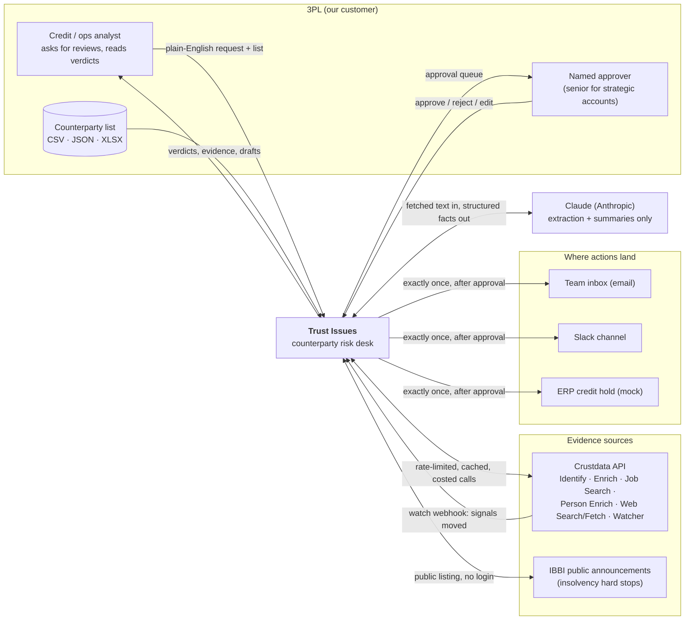
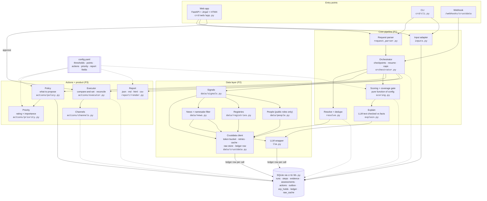
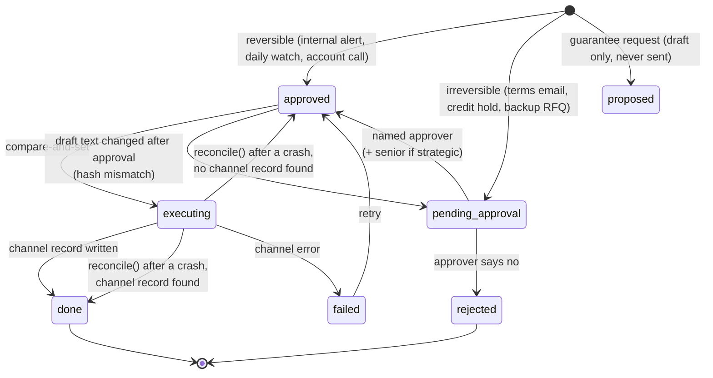
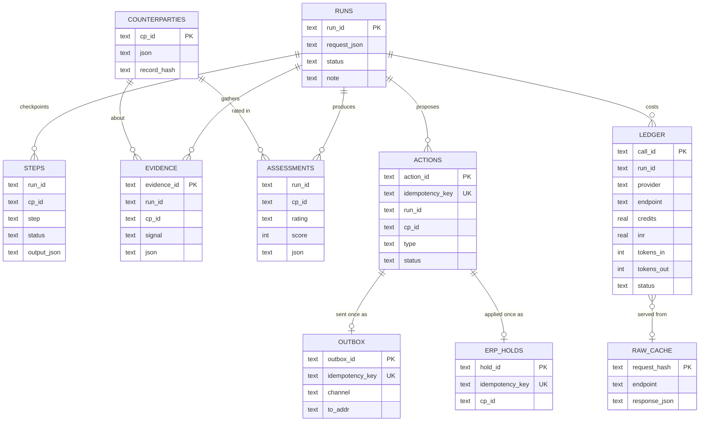
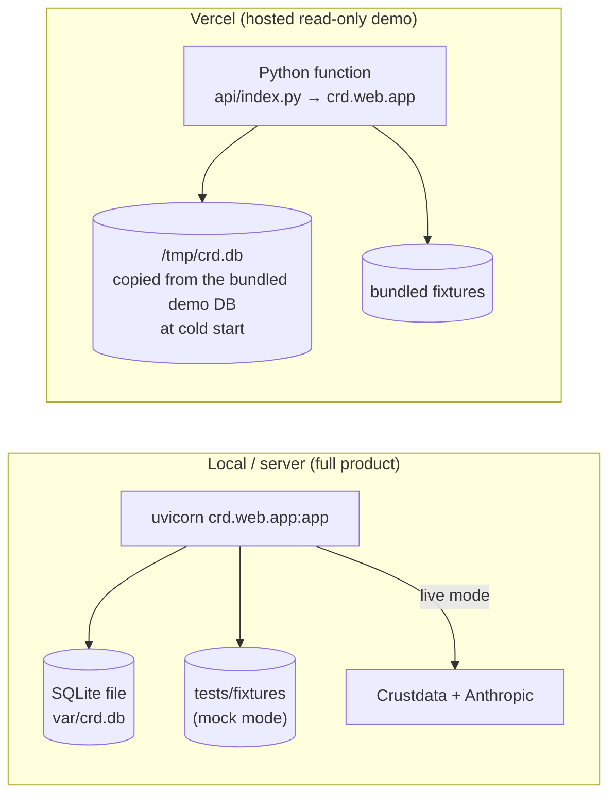

# Trust Issues: technical architecture

**T**hreat and **R**isk **U**nderstanding **S**ystem for **T**racking **I**nstitutional **S**tability.
This document is the engineering view: what the system is made of, how a review flows through it,
and which mechanism enforces each trust guarantee. The business view is in
[`BUSINESS_ARCHITECTURE.md`](BUSINESS_ARCHITECTURE.md); the step-by-step run notes are in
[`architecture.md`](architecture.md).

All diagrams are Mermaid and render on GitHub.

---

## 1. System context

Who and what Trust Issues talks to.



## 2. Components

Every external call goes through one client; every write goes through `crd/db.py`.



## 3. One review, end to end

```mermaid
sequenceDiagram
  autonumber
  actor U as Analyst
  participant W as Web / CLI
  participant O as Orchestrator
  participant R as Resolve
  participant C as Crustdata client
  participant S as Scoring
  participant P as Policy + priority
  participant D as SQLite
  actor A as Approver
  participant E as Executor
  participant X as Channels

  U->>W: "Run this week's review on our carriers"
  W->>O: parse request → scope (rules first; unknown name → clarifying question)
  O->>D: new run, status running
  O->>R: resolve all rows (batched Identify, 5/min key)
  R->>C: identify(domains), then identify(names)
  C-->>R: matches (cached, costed, raw stored)
  R-->>O: entities · duplicates merged · lookalikes = ambiguous
  O->>D: checkpoint resolve
  loop each entity
    O->>C: gather (Enrich, Job Search, news, registries)
    C-->>O: Evidence rows (failures = unavailable)
    O->>D: checkpoint gather
    O->>S: score(evidence, config)
    S-->>O: verdict, score, ₹ at risk, why
    O->>D: checkpoint score
    O->>P: propose(actions, priority)
    P->>D: insert actions (idempotency key: cp:type:week)
  end
  O->>D: finish run · render report
  A->>W: approve draft (name, maybe edit; senior for strategic)
  W->>D: pending_approval → approved (hash of approved text)
  E->>D: approved → executing (compare-and-set)
  E->>X: write channel record keyed by idempotency key
  X-->>E: external ref
  E->>D: executing → done
```

A `kill -9` at any point is safe: `resume()` reconciles actions left in `executing`, then continues
the unfinished run from its last checkpoint without repeating paid calls.

## 4. The action lifecycle



## 5. Data model



Every `Evidence` row carries `source`, `field_path` or `passage`, `url` or `raw_ref`, `record_date`
and `retrieved_at`. A fact without them is not stored.

## 6. Trust guarantees and what enforces them

| Guarantee | Mechanism | Proven by |
|---|---|---|
| No fact without a source | `Evidence` requires source + path/passage + url/raw_ref + dates; UI links each to its raw answer (**Sources** tab) | `tests/test_signals.py`, `tests/test_e2e_fixtures.py` |
| Silence is not health | Failed or timed-out source → `status="unavailable"`; a GREEN that relied on it → **HELD**; coverage gate blocks GREEN on thin evidence | `test_scoring.py::test_green_with_news_unavailable_is_held`, case 10 |
| Never guess identity | Unique only if top match = 1.0 and the next < 0.9; lookalikes → **CANNOT VERIFY**; dedupe never by name alone | `tests/test_resolve.py`, cases 04, 05, 06 |
| Deterministic verdicts | Scoring is a pure function of evidence + `config.yaml`; LLM never rates | case 11 (reworded), `test_deterministic_order` |
| Nothing irreversible without a human | Policy marks irreversible actions `pending_approval`; approve route requires a name, senior for strategic | `tests/test_executor.py`, `tests/test_priority.py` |
| Exactly once | Idempotency key `{cp}:{type}:{week}` unique in actions, outbox, erp_holds; compare-and-set; `reconcile()` on startup | `test_executor.py` (crash before/after write, 4 racing threads), kill demo |
| Kill-safe runs | Step checkpoints in SQLite; `resume()` skips finished steps, reuses cached calls | `test_orchestrator.py::test_kill_and_resume` |
| Bounded cost | Token buckets per endpoint; credit and time caps stop a run as `partial`; cache makes a re-run ~0 credits | `tests/test_crustdata_client.py`, ledger |
| Personal data minimum | People: name, title, employer, dates only; person raw data purged after each run; Sources tab never shows person endpoints and withholds contact fields | `tests/test_people.py` |
| Fetched text is data | LLM extracts into a schema; nothing in fetched text can trigger an action | `tests/test_news.py`, `tests/test_llm.py` |

## 7. Runtime and deployment



- **Modes:** `CRD_MOCK=1` replays recorded Crustdata answers from `tests/fixtures/` at 0 credits;
  a company with no recording is unavailable, never invented. Live mode needs
  `CRUSTDATA_API_KEY` (and optionally `ANTHROPIC_API_KEY`) in `.env`.
- **Hosted demo (Vercel):** serverless functions have a read-only filesystem, no long-running
  background work and short time limits, so the hosted copy is a **read-only demo**: it serves the
  bundled fictional portfolio, lets you browse, filter, simulate and open every file, and turns
  "Run review" off. Approvals made there live only in that instance's `/tmp`. Real reviews run on a
  machine with a persistent disk (`uvicorn`), which is also where the kill-and-resume guarantees hold.
- **Stack:** Python 3.11+, FastAPI, Jinja2, HTMX, SQLite, httpx, pydantic v2. No front-end build
  step; the UI is server-rendered with a little vanilla JS (`crd/web/static/crd.js`, `front.js`).
