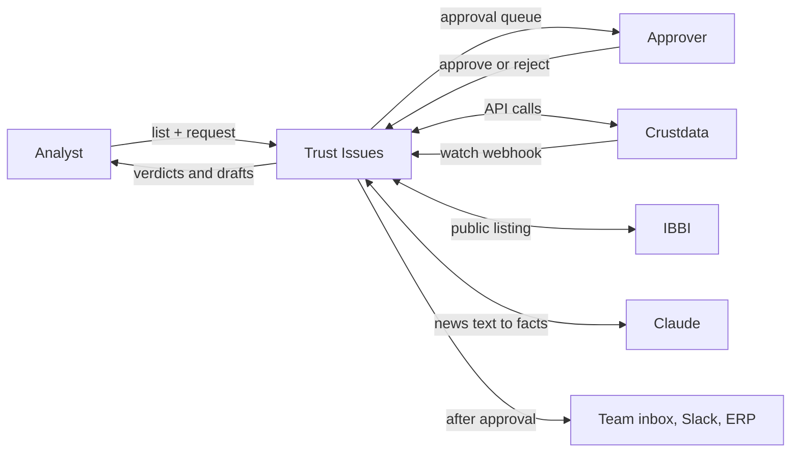
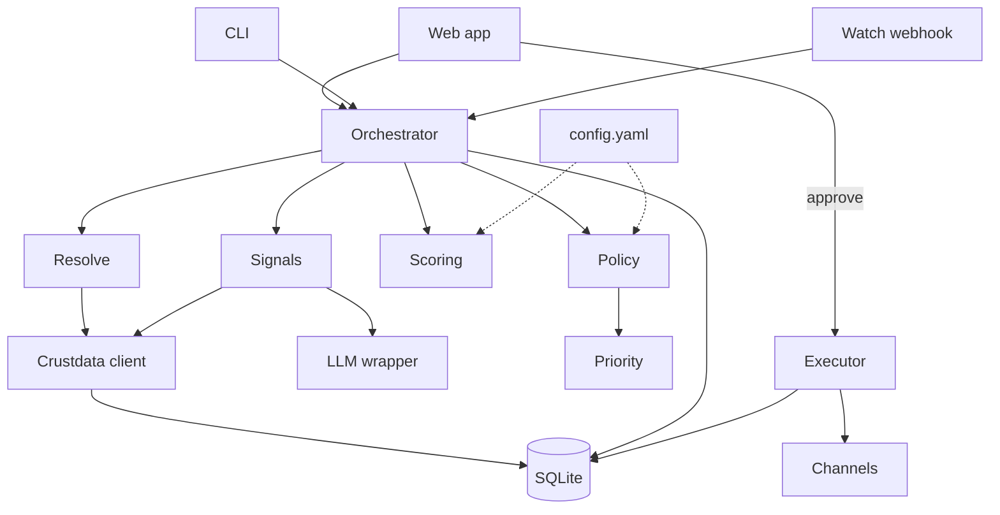
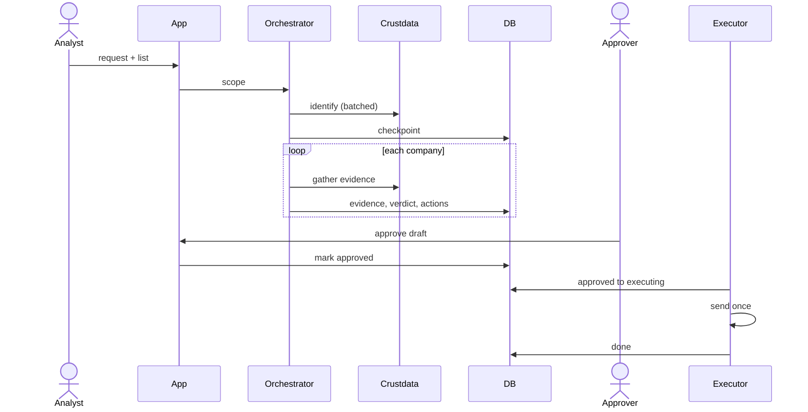
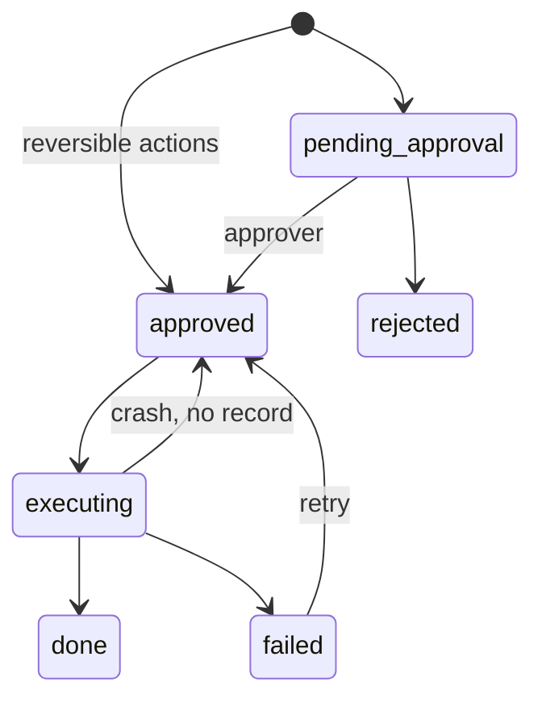

# Trust Issues: technical architecture

Trust Issues (Threat and Risk Understanding System for Tracking Institutional Stability) reviews the
carriers, warehouses and customers of a logistics company once a week. For each one it collects
evidence, scores it with fixed rules, and drafts follow-up actions that a person approves before
anything is sent.

This document covers how the system is put together. Pricing and costs are in the business
architecture document.

## 1. Context

The analyst uploads a list of counterparties and asks for a review in plain English. The system
pulls evidence from Crustdata and the IBBI insolvency listings, uses Claude only to pull facts out
of news text, and writes its verdicts, evidence and draft actions to a local database. A named
approver signs off on anything that cannot be undone. Approved emails and holds go to the team
inbox, Slack and a mock ERP.

## 2. Components

The code is split three ways, matching how the team worked.

- Core pipeline (`crd/`): request parsing, the input adapter, identity resolution, scoring, the
  orchestrator and the CLI.
- Data layer (`crd/data/`): the Crustdata client and the modules that turn its answers into
  evidence (signals, news, registries, people, watcher), plus the LLM wrapper.
- Actions and product (`crd/actions/`, `crd/report/`, `crd/web/`): priority, action policy,
  executor, channels, reports and the web app.

All external calls go through `crd/data/crustdata.py` or `crd/llm.py`. That one place applies rate
limits, retries, caching, stores the raw response and writes a cost row to the ledger. All database
access goes through `crd/db.py`.

## 3. How a review runs

1. The request parser turns the text into a scope. A name it cannot find in the list produces a
   question back to the user rather than a guess.
2. Resolve matches each row to one company: by domain first, then CIN or GSTIN, then name.
   Identify calls are batched because the API key allows five per minute. A name match only counts
   if the top result scores 1.0 and the next is below 0.9; otherwise the company is marked
   "can't tell". Duplicate rows are merged by company id, CIN, PAN or domain, never by name alone.
3. Gather collects evidence: headcount trends, hiring, news, employee reviews, web traffic,
   leadership changes and insolvency records. Each fact is stored with its source, the field it came
   from, a link or stored raw response, and the record date. A source that fails is stored as
   unavailable.
4. Scoring starts at 70 and adds or removes points per signal according to `config.yaml`. Insolvency
   admission, liquidation and similar hard stops force a red verdict. A green verdict needs enough
   fresh evidence; if it depended on a source that failed, it is put on hold instead.
5. Priority combines the verdict with how important the relationship is. It changes which action is
   proposed and how urgently, but never the verdict itself.
6. Policy proposes actions. Alerts and extra monitoring run on their own. Terms emails, credit holds
   and backup-carrier requests wait for approval.
7. After approval the executor sends each action once and records it.

Each step is checkpointed in SQLite. If the process is killed, `resume()` picks up from the last
finished step without repeating paid calls.

## 4. Sending actions exactly once

Every action has an idempotency key made of the company, the action type and the review week. The
key is unique in the actions table and in the outbox and ERP-hold tables. The executor moves an
action from approved to executing with a compare-and-set, writes the channel record under the same
key, then marks it done.

If the server dies mid-send, `reconcile()` runs at the next startup. If the channel record exists,
the action is marked done. If not, it goes back to approved and is sent once. If someone edits a
draft after it was approved, the stored hash no longer matches and the action returns to the queue.

## 5. Data model

SQLite tables: `runs`, `counterparties`, `steps`, `evidence`, `assessments`, `actions`, `outbox`,
`erp_holds`, `ledger`, `raw_cache` and `watch_events`. Evidence, assessments and actions are stored
as JSON of the pydantic models in `crd/models.py`, with the fields we query on pulled out as
columns.

## 6. What the tests cover

There are 178 automated tests. They cover the scoring rules, identity resolution and dedupe, the
Crustdata client against recorded responses, news classification, registries, the orchestrator
(including a simulated kill and resume), and the executor (two sends of one action, crashes before
and after the channel write, a draft edited after approval, and four threads racing on one action).

There are also 12 graded cases built on real companies and events after 1 September 2026, for
example a customer winding down, an insolvency admission, a CEO exit, a false alarm caused by a
demerger, and a lookalike name. All 12 pass against responses recorded from the live API on
22 November 2026.

## 7. Running it

Locally the app runs under uvicorn with a SQLite file. Mock mode replays recorded API responses at
no cost; a company with no recording is treated as unavailable, not as healthy. Live mode needs a
Crustdata key and, optionally, an Anthropic key.

The Vercel deployment is a read-only demo. Serverless functions have no persistent disk and cannot
run long background jobs, so it serves a bundled demo database and has "run review" switched off.
Real reviews run on a machine with a disk.

Stack: Python 3.11+, FastAPI, Jinja2, HTMX, SQLite, httpx and pydantic 2. The front end is
server-rendered with a small amount of plain JavaScript and has no build step.
