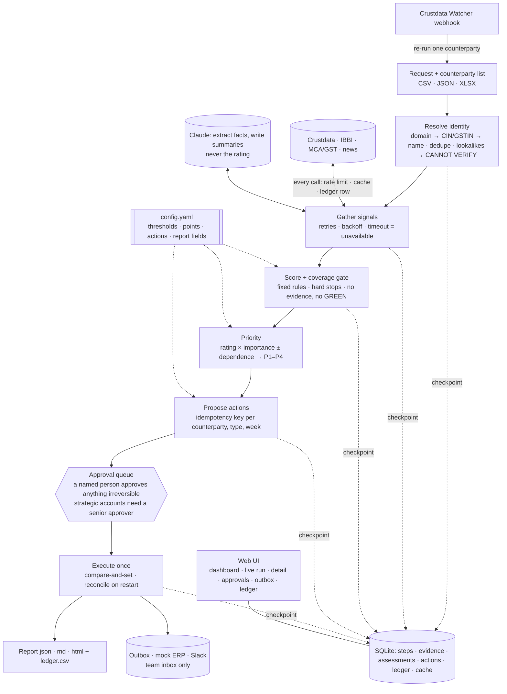

# Architecture — Counterparty Risk Desk

## How a run flows

1. **Request.** Free text ("run this week's review on our carriers", "check Tide India before we renew
   terms") is parsed by rules into a scope. A name that matches no counterparty produces a clarifying
   question, not a guess.
2. **Resolve.** Each row is matched to one company by domain, then CIN/GSTIN, then name. Identify calls are
   batched (the key allows 5 per minute). Rows that are the same company (same Crustdata id, CIN, PAN or
   domain) are merged. A name with several close matches is **CANNOT VERIFY**: we never pick one.
3. **Gather.** Crustdata Company Enrich (headcount, hiring, news, reviews, web traffic), Job Search, Person
   Enrich (leadership exits), Web Search/Fetch for news, and registries (IBBI, MCA, GST). Every fact becomes
   an `Evidence` row with its source, field path or quoted passage, URL or stored raw response, record date
   and retrieval time. A source that fails becomes `status="unavailable"`, never "no news".
4. **Score.** A pure function from config: start at 70 and add points per signal. Hard stops (CIRP admitted,
   liquidation, struck off, GST cancelled) make it RED. The coverage gate turns a GREEN without enough fresh
   evidence into CANNOT VERIFY. A GREEN that relied on an unavailable source becomes HELD. Merger news
   neutralises a headcount drop, namesake news is ignored, and stale evidence is shown but not scored.
5. **Priority.** The rating stays a pure health score. Priority is a separate layer:
   rating × importance (strategic, core, standard; sole-source suppliers count as strategic), with ±1
   for customers who depend on us more or less. It changes *how urgently and how hard* we act,
   never the rating.
6. **Propose.** Reversible actions run automatically (internal alert, daily watch). Irreversible actions
   wait for approval: customer terms email, ERP credit hold, backup-carrier RFQ. A guarantee request
   is a draft only. Each action's idempotency key is `{cp_id}:{type}:{review week}`, so a re-run or
   a resume never proposes it twice.
7. **Approve.** A named person approves in the UI. An edited draft is hashed, and the executor refuses
   to send if the text changed after approval. Strategic accounts need a senior approver.
8. **Execute once.** `approved → executing → done` by compare-and-set. The channel writes its record keyed
   by the idempotency key *before* anything else. After a crash, `reconcile()` at startup finds the channel
   record (→ done) or its absence (→ approved → send once).
9. **Report.** `review.json`, `review.md`, a printable `review.html` and `ledger.csv`, ranked by priority
   and ₹ at risk. The columns come from `config.yaml → report.fields`.

## Where the code lives

| Area | Files | Owner |
|---|---|---|
| Contracts, config, DB | `crd/models.py`, `crd/config.py`, `config.yaml`, `crd/db.py` | Arth (P1) |
| Pipeline | `crd/orchestrator.py`, `crd/resolve.py`, `crd/scoring.py`, `crd/explain.py`, `crd/request_parser.py`, `crd/inputs.py`, `crd/cli.py` | Arth (P1) |
| Data sources | `crd/data/*` (`crustdata.py`, `signals.py`, `news.py`, `registries.py`, `people.py`, `watcher.py`), `crd/llm.py`, `tests/fixtures/` | Nilay (P2) |
| Actions | `crd/actions/policy.py`, `priority.py`, `executor.py`, `channels.py` | Prachi (P3) |
| Report and UI | `crd/report/*`, `crd/web/*` | Prachi (P3) |
| Tests | `tests/test_executor.py`, `tests/test_priority.py`, `tests/cases/*.yaml` (P3) · the rest (P1, P2) | all |
